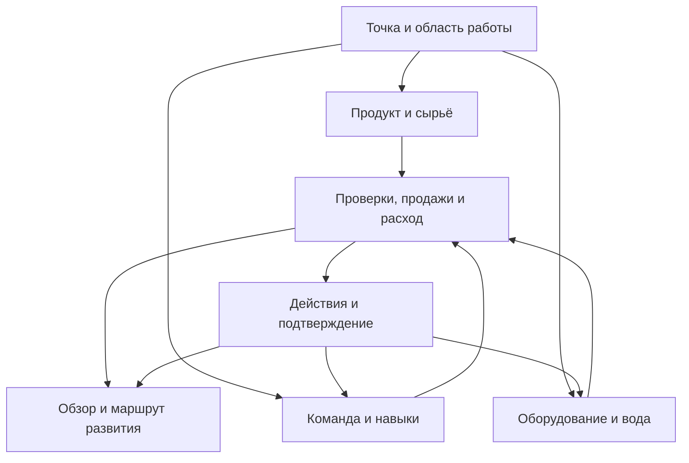

# Панель 03: карта улучшений и план развития единой системы

18 ноября 2026 года. Статус: предложенная целевая модель для поэтапного согласования. Новые уровни, сущности и правила ещё не реализованы в приложении.

Основание: повторная проверка [текущей сборки](https://github.com/htongrad/03-rabota/tree/a3e74f7fd421dcae6c47c0e0bdee42ca8feb8216), [содержательный аудит](role-content-audit.md) и [прежний план из 13 этапов](content-work-plan.md). Новый документ становится основным предложением по архитектуре развития; задачи прежнего плана сохраняются и распределяются по этапам ниже.

## 1. Главный результат повторного анализа

Существуют работающие связи: техкарта → проверка; ингредиент → закупочная позиция → расчёт; продажа → рецептура → расход; сотрудник → попытка; оборудование → работа/вода; поставщик → проба → цена; журналы → сроки → календарь. Нельзя считать панель полностью разрозненной.

Но общего контура целей, развития и принятия решений пока нет. Система в основном регистрирует отдельные факты. Следующая версия должна также объяснять последовательность работы, выбирать следующий полезный шаг, отслеживать зависимости и показывать последствия изменений.

Целевая модель: **личная система управления и практический гайд шеф-бариста, организованные как кампания развития кофейного направления сети**. Прогресс подтверждается результатами реальной работы и их актуальностью. Игровая логика задаёт маршрут и обратную связь.

## 2. Карта выявленных недочётов

| Код | Наблюдение | Необходимое улучшение | Проверка результата |
|---|---|---|---|
| S01 | Нет первого уровня, общей цели и рекомендуемого следующего действия | Маршрут развития с миссиями, условиями и объяснениями | Новый пользователь видит первый шаг; после результата получает следующий обоснованный шаг |
| S02 | Много пустых конструкторов, мало готовых программ | Библиотека редактируемых стартовых шаблонов | Проверка, обучение и визит выполняются по предложенному содержанию |
| S03 | Точки во многих формах вводятся текстом | Общий справочник точек и постоянные связи | Переименование не разделяет отчёты и историю |
| S04 | Часть связей зависит от названий и единиц | Постоянные идентификаторы порций, ингредиентов и критериев | Редактирование подписи не теряет связь с сырьём или стандартом |
| S05 | Текущее сопоставление ингредиента с сырьём применяется к историческим расчётам | Версии и область действия связей; явная политика исторического пересчёта | Замена сырья сегодня не молча меняет отчёт за прежний период |
| S06 | Обновление стандарта не формирует полный список затронутых объектов | Карта влияния и связанные действия | Видны затронутые точки, навыки, сотрудники, рецептуры и запуски |
| S07 | Рабочие действия разложены по разным структурам журналов | Общий связанный реестр действий с владельцем, сроком, причиной и подтверждением | Одна проблема прослеживается от обнаружения до результата без повторного ручного ввода |
| S08 | Сводки не объединены в картину готовности и развития сети | Раздельные сведения о результате, охвате, актуальности и проблемах | Можно объяснить состояние сети и открыть его источники |
| S09 | Не заданы общие правила применимости и вариантов работы | Шаблон сети с разрешёнными настройками по точкам и методам | Фильтр или конкретное оборудование не навязывается точке, где этого нет |
| S10 | Нет истории прохождения маршрута и актуальности достигнутого | Достижения отдельно от текущей готовности | Старое достижение остаётся в истории, новое нарушение становится видимым |
| S11 | Недостаточны аудит точки, сменные процедуры, санитария, сервис и инциденты | Полные рабочие циклы в связанных разделах | Обязанность имеет программу, факт, решение и подтверждённое завершение |
| S12 | Неполны внедрение ассортимента, допуски, прослеживаемость партий и управленческая экономика | Сквозные сценарии с зависимостями | Запуск не завершён без готовности точек; экономика опирается на понятные полные данные |

Недочёты F01–F08 предыдущего аудита сохраняются: актуальность навыков; пропуски; неизвестные возвраты; противоречивые решения по пробам; норматив и факт экономики; активация и внедрение; условия закупок по точкам; приёмка оборудования.

### Что дополнительно проверено в коде

Повторно воспроизведены F01–F04. Дополнительно проверены S04–S05: переименование ингредиента меняет ключ связи; переназначение текущей связи с закупочной позиции A на B меняет рассчитанную стоимость для той же прошлой даты. Это подтверждает необходимость постоянных идентификаторов и истории связей.

Связь с выбранным критерием рецептуры в обучении частично записывается как текстовое описание источника и копия правила. Такая запись полезна для чтения истории, но недостаточна для надёжного автоматического определения всех затронутых попыток после изменения конкретного критерия. Полноту связей нужно проверять также по версиям, порциям и критериям, а не только по существованию карточки.

## 3. Как устроена игровая логика

**Кампания** — развитие кофейного направления всей сети.

**Уровень** — достигнутая способность управлять определённой частью направления.

**Миссия** — реальная рабочая задача с целью, входными данными, шагами и подтверждением результата.

**Подзадача** — небольшой выполнимый шаг миссии.

**Веха** — зафиксированный результат: например, проведён первый полный аудит, подтверждён стандарт на всех применимых точках или проверен эффект изменения.

**Повторяющийся цикл** — поддержание качества, обучение, обслуживание и план-факт после первоначального освоения.

Система показывает отдельно:

- маршрут развития шеф-бариста и сети;
- текущую готовность каждой точки и направления;
- приоритетные проблемы и обязательные действия;
- достигнутые вехи и их доказательства;
- пробелы и свежесть исходных данных.

Сохранение записи, чтение подсказки или множество одинаковых действий само по себе не подтверждает достижение уровня. Число выполненных миссий показывает объём прохождения, но не заменяет оценку качества и критические ограничения.

Все рабочие вкладки доступны независимо от уровня. Предварительные условия определяют, можно ли подтвердить готовность, допуск или запуск, а не запрещают открыть журнал и решить срочную проблему. Реальная сеть уже работает: допускается зачесть существующие результаты после проверки их данных, актуальности и применимости.

## 4. Стартовый маршрут: восемь уровней

Порядок рекомендательный; зависимые результаты проверяются явно. Часть задач выполняется параллельно.

| Уровень | Основная цель | Стартовые миссии | Условие подтверждения |
|---|---|---|---|
| 1. Карта направления | Понять исходное состояние и границы ответственности | Паспорт должности; роли; точки; состав меню, команды и техники; первичная диагностика | Определён действующий контур сети, известные факты и пробелы; у обнаруженных важных проблем есть действия |
| 2. Готовый к работе бар | Организовать базовую готовность и контроль ограничений | Открытие/закрытие; хранение и аллергены; чистка; пригодность техники и воды; порядок реакции | Все обязательные применимые условия готовности подтверждены и актуальны; в заявляемом объёме работы нет неустранённых критических ограничений и неизвестных обязательных результатов |
| 3. Воспроизводимый напиток | Зафиксировать и подтвердить стандарты продукта | Техкарты; сырьё и партии; настройка; методы приготовления; сенсорная калибровка | Для действующего меню определены нормы и методы, обязательные контрольные результаты актуальны, воспроизводимость подтверждена по согласованной программе |
| 4. Подготовленная команда | Обеспечить применение стандартов сотрудниками | Матрица навыков; ввод новичка; самостоятельная проверка; актуальность допуска; отработка | Обязательные пары «сотрудник — навык» в заявленном объёме имеют актуальное подтверждение; незавершённое обучение и ограничения видны и не засчитываются как готовность |
| 5. Понятная экономика | Понимать затраты, расход и результат решений | Паспорта показателей; продажи; возвраты/переделки; норматив и факт; сверка; потери; план-факт | Состав показателей согласован; для заявленных выводов есть необходимые проверенные данные за выбранный период; существенные пробелы не скрыты; расхождения имеют разбор и действия |
| 6. Стабильная работа точек | Поддерживать результат регулярно | План визитов; аудиты; сервис; наличие сырья; обслуживание; повторы отклонений; оценка эффекта обучения | За согласованный рабочий цикл проверены охват, своевременность, повторяемость и выполнение стандартов; незакрытые проблемы видны |
| 7. Управляемые изменения | Развивать ассортимент и процессы без потери контроля | Разработка; проба; пилот; оценка экономики; подготовка точек; обучение; запуск; проверка эффекта | Изменение прошло согласованные условия, введено на подготовленных точках, результат оценён по заранее заданным критериям |
| 8. Управляемая сеть | Принимать решения по целостной картине | Цели; обзор сети; причины отклонений; приоритеты; распределение ресурсов; план улучшений и оценка эффекта | Регулярный цикл решений опирается на прослеживаемые данные качества, людей, продукта, оборудования, сырья, сервиса и экономики |

Уровни — стартовый шаблон. Для сети, которая уже умеет часть перечисленного, первый проход является диагностикой и подтверждением существующих результатов. Масштабирование, открытие новой точки, обучение наставников, сезонный ассортимент и особые методы приготовления добавляются как применимые ветви развития.

Панель проверяет полноту записей, связи и условия правил. Фактическое наблюдение, профессиональная оценка и решение подтверждаются ответственным человеком в принятом порядке.

Подтверждение уровня проверяется по всем обязательным условиям и заявленной области действия. Наличие плана устранения само по себе не означает устранение нарушения. Диагностическую миссию можно завершить фиксацией проблемы и действием; миссию готовности — только выполнением её условий. Отказ от неудачного пилота может подтвердить завершение управленческого разбора, но не считается успешным запуском продукта.

Каждая точка имеет собственную готовность. Успех одной кофейни не означает готовность всех. Общесетевой вывод показывает, какие точки включены, какие исключены с основанием и где данных нет.

### Достижение и текущая готовность

Историческую веху сохраняем. Если стандарт изменился, закончился срок подтверждения, возникла неисправность или появились неполные данные, меняется текущая готовность и формируется действие. Профиль не скрывает проблему ради сохранения достигнутого уровня. Актуальность проверяется по зависимостям, версии, сроку и применимости.

Рекомендуемые состояния миссии: «Предложена», «Не хватает исходных данных», «Готова к выполнению», «В работе», «На проверке», «Подтверждена», «Нужна актуализация». Состояние «Не применяется» допускается с основанием и областью действия. Эти подписи и правила являются предложением, которое уточняется перед реализацией.

## 5. Единая модель взаимосвязей

Смысл требования «всё связано» — единые исходные факты, прослеживаемые связи и понятные последствия изменений. Каждое поле связано со своей сущностью и процессом; произвольное распространение любых изменений во все журналы не требуется.

| Общая сущность | Что с ней связано |
|---|---|
| Сеть и точка | Роли, меню, сотрудники, техника, сырьё, проверки, продажи, визиты, цели и готовность |
| Стандарт и его версия | Метод, источник, критерии, проверки, навыки, обучение и условия запуска |
| Продукт, порция и ингредиент | Рецептуры, закупочные позиции и их версии, аллергены, партии, себестоимость, продажи, расход и запуски |
| Сотрудник, роль и навык | Назначенная программа, попытки, применявшиеся нормы, актуальность допуска и связанные действия |
| Оборудование и прибор | Точка, документация, обслуживание, вода, замеры, пригодность и качество продукта |
| Сырьё, партия и поставщик | Приёмка, проба, хранение, применение на точках, замена, цена и претензия |
| Аудит, наблюдение и инцидент | Программа проверки, фактические результаты, критичность, причина, действия и подтверждение |
| Действие | Источник, связанные объекты, ответственный, срок, статус, подтверждение и проверяющий |
| Разработка и запуск | Версии рецептур, сырьё, экономика, техника, обучение, готовность точек и результат пилота |
| Календарное событие | Визит, действие, обучение, запуск или другая рабочая цель; дата, время, источник и точка при применимости; зеркало Google |
| Показатель и отчёт | Определение и версия формулы, источники, период, единицы, область, полнота, цель и связанные решения |
| Миссия, цель и веха | Требуемые данные и результаты, подтверждение, актуальность, следующий шаг и влияние на готовность |

Для общих объектов нужны постоянные идентификаторы. Названия служат для чтения, а не заменяют идентификаторы. Отдельно задаются версия, область действия, дата или время применения, источник и подтверждение там, где это необходимо.

Упрощённая карта взаимосвязей:

Производные показатели и готовность рассчитываются из исходных записей. Исторические наблюдения сохраняют фактические нормы, которые применялись тогда. Исправление факта возможно как прослеживаемая корректировка; история не меняется без объяснения. После восстановления копии готовность пересчитывается, а отсутствующие данные не заполняются выдуманными подтверждениями.

## 6. Как сведения переходят между разделами

| Событие | Что система связывает или пересчитывает | Что требует решения человека |
|---|---|---|
| Изменилась закупочная цена | Нормативная себестоимость затронутых порций, сценарии экономики и список затронутых продуктов | Изменение продажной цены, рецептуры или поставщика |
| Изменилась рецептура или критерий | Область применения, затронутые точки, навыки, сотрудники, программа проверки, экономический расчёт и миссии | Утверждение стандарта, существенность изменения, дата ввода и условия переподготовки |
| Получена новая партия | Связь с поставщиком, приёмкой, пробой и точками применения; при необходимости задача настройки | Одобрение и допустимые условия применения |
| Обнаружено отклонение | Связанное действие, срок, критичность, видимость в обзоре и календаре; влияние на готовность | Причина, решение об ограничении работы и подтверждение устранения в пределах полномочий |
| Возникла неисправность | Работа по оборудованию, затронутые позиции меню, точки и связанные задачи проверки | Временное решение, сервисное вмешательство и приёмка |
| Сотрудник не подтвердил навык | Отработка, срок и актуальность допуска; связь с наставником и стандартом | Практическая проверка, оценка самостоятельности и подтверждение |
| Внесены продажи, переделки или движения сырья | Нормативный расход, сверка, показатели экономики и полнота данных | Подтверждение полноты, разбор расхождения и выбор действия |
| Подготовлен запуск | Проверка требований по продукту, сырью, технике, команде и экономике на каждой точке | Утверждение и решение о запуске |
| Подтверждён результат действия | Обновление готовности связанных объектов, миссий и сводок; снятие закрытого рабочего срока | Проверка эффективности и подтверждение завершения |

Пересчёт и создание предлагаемого следующего шага не равны автоматическому одобрению. Система показывает влияние изменения до его ввода и не переписывает историю молча. Повторный пересчёт не создаёт дубликаты задач и календарных копий. Для одного вопроса допускаются несколько связанных действий, но исходная проблема общая.

Пример сквозного пути: новая партия зерна → проба → решение → настройка на точке → подтверждение качества → проверка навыка при необходимости → применение в продажах → расход и экономика → разбор отклонений → результат в обзоре развития. По любому итогу можно открыть подтверждающие записи.

## 7. Гайд внутри каждого рабочего процесса

Миссия и рабочая процедура должны содержать:

1. Цель и результат для направления.
2. Почему этот шаг нужен сейчас.
3. Предварительные условия и уже доступные сведения.
4. Короткое объяснение метода.
5. Подготовку: оборудование, документы, образцы и участники, если нужны.
6. Пошаговое действие.
7. Редактируемую заготовку формы и пример заполнения, обозначенный как пример.
8. Критерии оценки, применимость и правила полноты.
9. Действия при отклонении или невозможности выполнить проверку.
10. Условия подтверждения, согласование и источник доказательства.
11. Список связанных разделов и последствий изменения.
12. Следующий шаг и период возвращения к вопросу.

Стартовые рекомендации и выбор следующего шага работают локально по утверждённым правилам и шаблонам, используя реальные записи панели.

Краткое пояснение открывается у элемента. Полная процедура доступна из того же контекста; инструкция собирает актуальные утверждённые процедуры в единый справочник должности. Учебные материалы и рабочие шаблоны связаны с реальными задачами. Прочитанная справка не подменяет практическое подтверждение.

## 8. Редактируемость и варианты работы

Базовая иерархия: стартовый шаблон → утверждённый стандарт сети → допустимая настройка точки → конкретная запись с применявшейся версией.

Можно редактировать названия и описания, состав меню и применимые методы, роли и программы, критерии и методы, согласованную периодичность и цели, допустимые варианты и последовательность необязательных ветвей. Перед изменением значимого правила система показывает затронутые объекты и необходимость актуализации.

Изменение нормы — новая версия. Исключение — отдельное обоснованное решение с областью и сроком. Историческое измерение не меняется от редактирования шаблона. Применимость и исключение не используются для скрытого снятия обязательных критических проверок.

Числовые санитарные пределы, сроки хранения, разрешения на работу, экономические цели и бюджеты задаются по применимым документам и согласованным правилам сети. До этого соответствующие заготовки обозначаются как требующие настройки. Демонстрационные записи не попадают в реальные показатели и прохождение уровней.

## 9. Навигация и общая картина

Сохраняются «Обзор» и «Календарь», текущие рабочие вкладки и отдельные нижние вкладки самостоятельных модулей. Предлагается новая вкладка **«Развитие»**: маршрут, текущая миссия, условия, вехи и следующий шаг.

Для общих справочников и процессов понадобятся рабочие места «Точки», «Аудиты», «Действия» и «Запуски». Их точный состав и расположение согласуются на мобильных макетах, прежде чем писать интерфейс. Самостоятельные разделы не заменяются окнами в обзоре.

Обзор отвечает на вопросы: где требуется реакция сейчас; что делать следующим; в каком состоянии точки; чему можно доверять в данных; что изменилось; как идёт развитие. Критическая проблема видна независимо от текущего уровня.

Из любого результата доступен переход к исходным фактам; из карточки объекта — связанные результаты, задачи и руководство. Фильтры точки, периода, продукта и области действия должны применяться последовательно, чтобы разные разделы показывали сопоставимую картину. Общесетевые показатели рассчитываются только по совместимой базе; разные единицы, методы и неполные области не усредняются в один необъяснимый балл.

## 10. Стартовый шаблон миссии

**Миссия 1.1 — «Определить контур ответственности».**

**Цель:** описать, чем шеф-бариста управляет в этой сети, какие результаты должен обеспечивать и с кем согласует решения.

**Стартовая заготовка:**

- Назначение: обеспечивать воспроизводимое качество напитков, подготовленность команды и управляемую экономику кофейного направления сети.
- Направления: качество; рецептуры и ассортимент; обучение; оборудование и вода; сырьё; экономика; организация контроля и улучшений.
- Область: действующие точки и применимое меню; конкретный состав выбирается из справочников.
- Рабочие партнёры: управляющие точек, ответственные бариста/наставники, закупки, сервис, финансы и руководитель направления бизнеса. Фактические роли редактируются.
- Результаты: утверждённые стандарты; программа контроля; актуальные подтверждения навыков; разобранные отклонения; понятные экономические показатели; проверенные результаты изменений.
- Полномочия: для решений по стандартам, обучению, сырью, ограничениям работы, расходам и запуску требуется заполнить правило «самостоятельно / согласование / передача ответственному».

**Шаги:** уточнить область → выбрать или отредактировать роли → определить результаты → заполнить полномочия → отметить нерешённые вопросы → подтвердить рабочую версию.

**Подтверждение:** обязательные поля заполнены, неизвестные полномочия явно отмечены и имеют следующий шаг; документ может оставаться рабочим черновиком до необходимого согласования. Подтверждённым паспорт считается после выполнения принятого порядка согласования. Сохранение черновика не означает наделение полномочиями.

**Данные на выходе:** версия паспорта и схема ответственности. Они используются в назначении задач, аудитах, согласовании стандартов и запусков.

**Следующая миссия:** собрать карту действующих точек и выполнить первичную диагностику. Если во время неё обнаруживается срочная проблема, работа с ней начинается сразу.

Это первый предложенный шаблон содержания. Подробные тексты и нормативы каждого следующего шага предъявляются поэтапно.

## 11. План разработки системы

Уровни пользователя и этапы разработки — разные последовательности. Пользователь проходит путь развития направления. Мы строим поддерживающие его возможности небольшими готовыми частями.

| Этап разработки | Содержание и результат | Условие завершения |
|---|---|---|
| D0. Целевая модель | Согласовать маршрут уровней, общие объекты, состояния, полномочия и правила подтверждения; определить обязательную и вариативную части | Понятно, с чего начинается работа, как подтверждается результат и что влияет на следующий шаг |
| D1. Мобильный сценарий и первая полезная версия маршрута | Показать несколько мобильных макетов развития и миссии в принятом дизайне; затем реализовать паспорт, точку, первичную диагностику, связанное действие и календарный срок | Пройден путь «первая точка → исходная проверка → действие → подтверждение → обзор»; данные восстанавливаются из копии |
| D2. Общие решения и устранение ложных статусов | Обязательность, критичность, полнота, актуальность; F01–F04; общие действия и объяснение блокирующих условий; корректные обозначения нормативной экономики | Воспроизведённые разрывы исправлены; прогресс опирается на факты; неизвестное и пропуск не дают ложной готовности |
| D3. Готовность бара и воспроизводимый продукт | Уровни 2–3: сменные процедуры, санитария и аллергены, техника и вода, программы качества, рецептуры, партии, настройки и калибровки | Утверждённые шаблоны позволяют проверить применимое меню и готовность точки; нормы и источники известны |
| D4. Подготовленная команда | Уровень 4: роли, программы, наставники, ввод, практические проверки, допуски и изменение стандарта | Изменение значимого критерия показывает затронутые навыки/людей и необходимые действия; история сохранена |
| D5. Управляемая экономика | Уровень 5: F05/F07, норматив и факт, стоимость потерь, возвраты/переделки, закупочные условия, план-факт, анализ влияния | Показатели прослеживаются до рецептуры, цены, продажи и расхода; неполнота явно видна; двойного учёта нет |
| D6. Стабильные операции сети | Уровень 6: план визитов, аудиты, сервис, жалобы, наличие, партии, оборудование и F08, повторы проблем и проверка эффективности | За рабочий цикл показаны охват точек, ограничения, сроки, причины и результаты действий |
| D7. Изменения и развитие продукта | Уровень 7 и F06: разработка, пилот, экономика, обучение, сырьё, готовность точек, запуск и оценка эффекта | Запуск подтверждается только для подготовленного объёма, затронутые разделы согласованы |
| D8. Обзор управления сетью | Уровень 8: цели, сопоставимые показатели, причины, решения, планы улучшений; применимые ветви масштабирования | По картине сети можно выбрать действие и проверить его влияние; каждый показатель раскрывает источники |
| D9. Сквозная приёмка и завершение гайда | Проверить связи, версии, вариативность, все процедуры и пояснения, сохранение/восстановление, мобильные сценарии и несколько рабочих циклов | Все согласованные рабочие сценарии выполняются от цели до проверенного результата; ограничения указаны |

Экономическая методология обсуждается уже в D0, неизвестные возвраты и обозначения показателей исправляются в D2. Полный управленческий блок развивается в D5 после создания надёжных источников. Подготовку исходных экономических данных можно выполнять параллельно с другими миссиями.

Каждый этап включает: предложенный шаблон → корректировки → согласованную инструкцию → формы и связи → пояснения → проверки → публикацию → обновление паспорта. Для новых сущностей сразу предусматриваются идентификаторы, версии, перенос старых данных, копия и восстановление. Неоднозначные старые связи проверяются пользователем; данные не угадываются и не удаляются.

## 12. Покрытие прежнего плана

| Задачи прежнего плана | Новые этапы |
|---|---|
| Паспорт, полномочия и рабочий ритм | D0–D1 |
| F01–F04, общая модель оценки | D2, затем развитие соответствующих процессов |
| Точки и единые связи | D1 и сквозное развитие всех этапов |
| Экономика и область действия условий | D0/D2 — определения и исправления; D5 — полный блок |
| Аудиты и отклонения | D1 — первый связанный сценарий; D2/D6 — полноценный процесс |
| Сменные процедуры, санитария, аллергены | D3 |
| Спешелти-качество и калибровки | D3 |
| Обучение и допуски | D2/D4 |
| Оборудование, вода, приёмка | D3/D6 |
| Партии, поставщики, доступность | D2/D3/D6 |
| Ассортимент и внедрение | D7 |
| Сервис, сводка и улучшения | D6/D8 |
| Сквозная приёмка | D9 |

## 13. Обязательные проверки итоговой системы

1. Переименование точки, ингредиента или критерия не разрушает связи.
2. Изменение стандарта показывает затронутые объекты и формирует предлагаемые действия; старые факты остаются читаемыми.
3. Влияние новой цены видно до решения изменить меню; прежний отчёт не меняется без предусмотренной политики пересчёта.
4. Критическая проблема видна на любом уровне и на общесетевом обзоре.
5. Пропуск и неизвестное значение не превращаются в соответствие или ноль.
6. Историческое достижение отделено от текущей готовности.
7. Миссия подтверждается результатом; повторное сохранение не создаёт новый прогресс.
8. Необязательная ветвь не блокирует неприменимую точку; исключение обосновано и прослеживается.
9. Допуск, одобрение и запуск требуют положенных подтверждений и согласований.
10. Любая цифра и статус показывают источник, период, версию, область действия и полноту, где это требуется.
11. Восстановление копии сохраняет связи и пересчитывает готовность; новые сущности входят в резервирование.
12. Срочная работа доступна независимо от маршрута; рабочие разделы имеют собственный прямой доступ.
13. Руководство позволяет выполнить каждую согласованную обязанность без необходимости самостоятельно изобретать процедуру.

## 14. Следующий небольшой шаг

Предлагается согласовать базовый маршрут восьми уровней и правила прохождения, затем детализировать миссии уровня 1 и связанные сущности. После этого показать мобильные варианты вкладки «Развитие», карточки миссии и общей картины сети. Только после согласования этой модели начинается реализация первого связанного рабочего сценария.

Архитектура хранения остаётся прежней: локальные данные — основа, Google Диск — резервирование, Google Календарь — одностороннее зеркало. Обмен в этой стратегии относится к элементам панели 03. Многопользовательский сервер или автоматическая работа при закрытой панели не предполагаются.

Рекомендуемая модель — GPT‑6.2.

## 15. Сборка перед вводом в работу

Сначала собираем полный маршрут D0–D9 и проверяем его на тестовых данных. Реальный ввод в работу начинается после сквозной приёмки. Результаты первых рабочих циклов определят, какие шаги и поля уточнить уже на опыте сети.

- D1 в сборке для проверки включает паспорт, карту точек, первичную диагностику, связанные действия со сроками, перепроверку и подтверждение исходной картины. Подтверждение диагностики фиксирует исходное состояние. Устранение отдельного отклонения подтверждается своим результатом перепроверки.
- В следующем блоке D2 проверяем обязательность, полноту и актуальность результатов. Затем доводим функции D3–D8 до их условий готовности из плана.
- Перед вводом в работу проходим D9 на чистом наборе и на копии имеющихся данных. Проверяем работу с телефона, восстановление и синхронизацию, затем принимаем единое решение о выпуске рабочей версии.
- Рабочий выпуск остаётся на основной ветке. Следующие блоки собираются отдельно, пока не пройдена приёмка всей системы.
